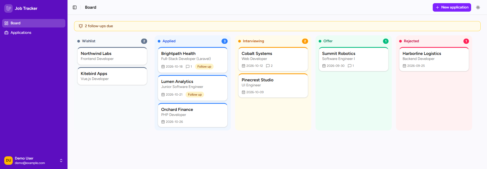
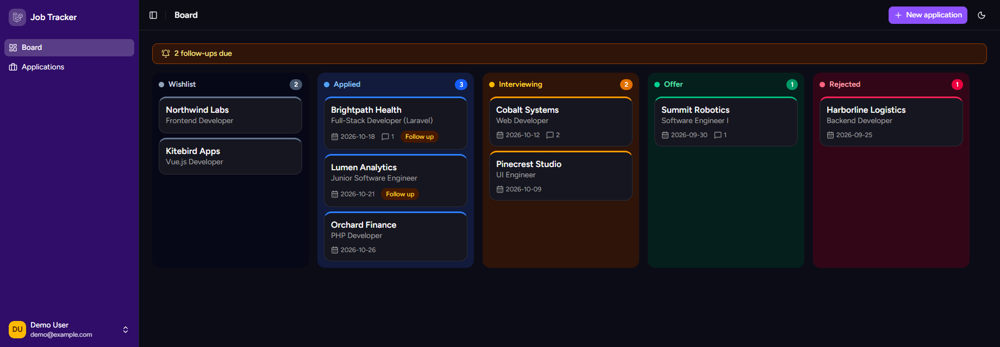
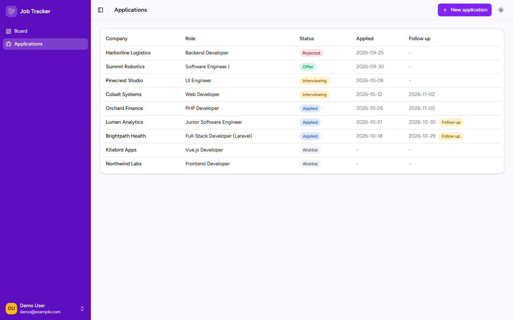
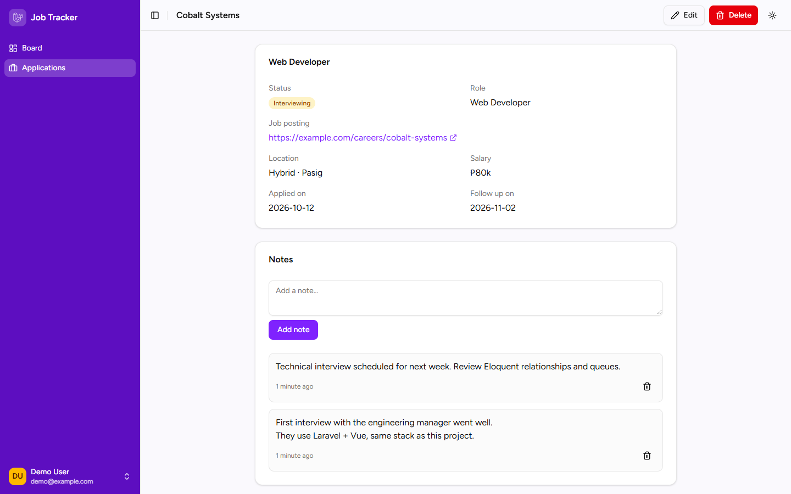
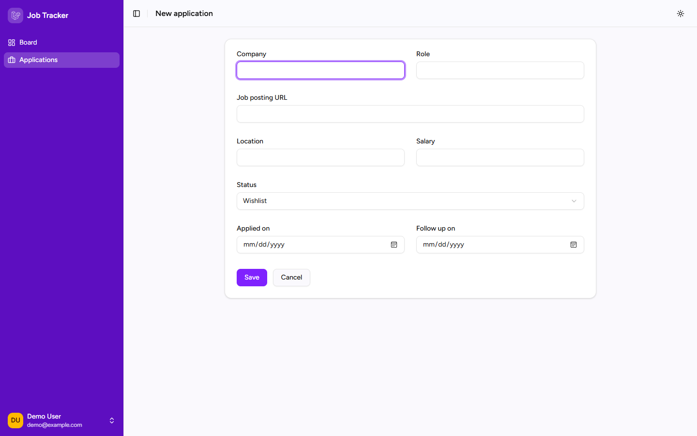
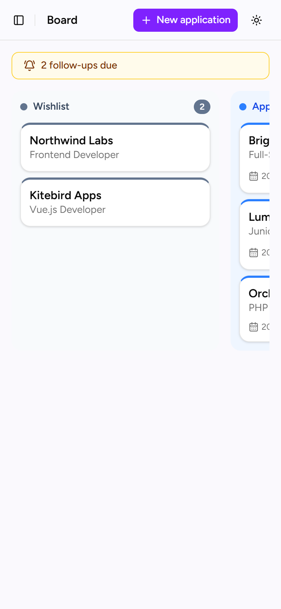
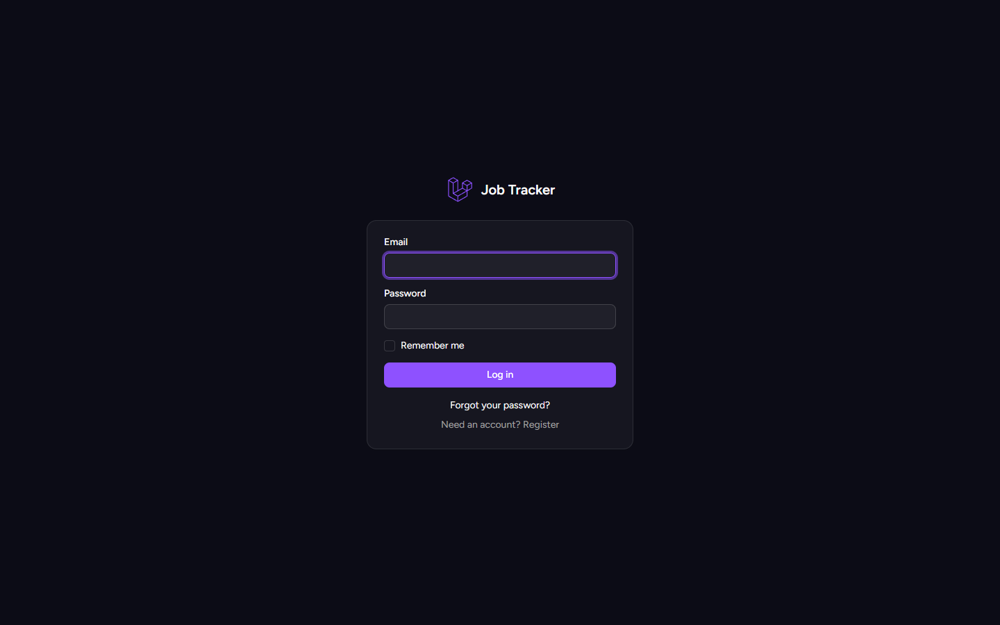

# Job Tracker

A Kanban-style job application tracker. Drag applications between stages, keep notes for each company, and get reminded when it's time to follow up.

Built with Laravel 12, Inertia.js, Vue 3 (TypeScript), Tailwind CSS 4 and shadcn-vue.



## Features

- **Kanban board.** Five stages (Wishlist, Applied, Interviewing, Offer, Rejected), each with its own colour. Drag cards between columns or reorder them within a column; the order is saved.
- **Applications.** Create, edit and delete applications with company, role, job posting URL, location, salary, applied date and follow-up date.
- **Notes.** A running log of notes for each application, newest first.
- **Follow-up reminders.** Cards show a "Follow up" badge when a follow-up date is due, the board shows how many are due, and a daily email lists them.
- **Light, dark and system themes.** Remembered per browser, with no flash on page load.
- **Responsive layout.** A collapsible sidebar that becomes a slide-out menu on phones; the board scrolls sideways on small screens.
- **Private by default.** Every user only sees and changes their own applications.

## Screenshots

| Dark mode | Applications list |
| --- | --- |
|  |  |

| Application detail and notes | New application form |
| --- | --- |
|  |  |

| Mobile | Log in |
| --- | --- |
|  |  |

## Tech stack

| Layer | Tools |
| --- | --- |
| Backend | PHP 8.2+, Laravel 12, SQLite |
| Frontend | Vue 3 + TypeScript via Inertia.js, Ziggy for routes |
| UI | Tailwind CSS 4, shadcn-vue (Reka UI), lucide icons, vue-sonner toasts |
| Drag and drop | vue-draggable-plus (SortableJS) |
| Auth | Laravel Breeze |
| Tests | PHPUnit (75 feature and unit tests) |

## Getting started

Requirements: PHP 8.2+, Composer, Node.js 20.19+ and npm.

```bash
git clone https://github.com/ginabeth-web/job-application-tracker.git
cd job-application-tracker

composer install
npm install

cp .env.example .env
php artisan key:generate
php artisan migrate
```

Load the demo data (optional):

```bash
php artisan db:seed --class=DemoSeeder
```

This creates a local demo account, `demo@example.com` with the password `password`, filled with fictional applications. Use it on your own machine only.

Start the app (Laravel server, queue worker, logs and Vite together):

```bash
composer run dev
```

Then open http://localhost:8000.

## Follow-up reminder emails

The command `applications:send-follow-up-reminders` emails each user a list of their due follow-ups. It's scheduled daily at 08:00 in `routes/console.php`.

Run it by hand:

```bash
php artisan applications:send-follow-up-reminders
```

In production, add the Laravel scheduler to cron so it runs every minute:

```
* * * * * cd /path/to/app && php artisan schedule:run >> /dev/null 2>&1
```

Locally, `MAIL_MAILER=log` writes the emails to `storage/logs/laravel.log`.

## Running tests

```bash
php artisan test
```

Type-check and build the frontend:

```bash
npm run build
```

## Project structure

```
app/
  Enums/ApplicationStatus.php          stages, labels and board order
  Models/Application.php               ordering (moveTo) and the "follow-up due" scope
  Http/Controllers/                    board, applications, notes, move endpoint
  Console/Commands/                    daily follow-up reminder command
resources/js/
  Pages/                               Inertia pages (Board, Applications, Auth, Profile)
  Components/                          board columns, cards, forms, sidebar, header
  Components/ui/                       shadcn-vue components
  lib/status.ts                        status colours, used everywhere a status is shown
  composables/useAppearance.ts         light / dark / system theme
docs/
  superpowers/plans/                   implementation plans for each feature
  screenshots/                         images used in this README
```

## How it was built

The project was built one feature branch at a time (CRUD, Kanban board, notes, follow-up reminders, then the shadcn-vue restyle). Each branch was planned first, built test-first, and code-reviewed before being merged. The plans are in `docs/superpowers/plans/`.
